# PROJECT_MAP.md - System Architecture & Route-to-DOM Graph
Project: **School of Character (SoC) - Pojok Hope**
Architecture Methodology: **Graphify-Style Bidirectional Mapping**

---

## 1. Graphify Visual Architecture Diagram

```mermaid
graph TD
    subgraph Client_Sidebar["Sidebar Navigation (dashboard.html)"]
        M_Dash["#menu-dashboard<br/>(data-view: ringkasan)"]
        M_SchedM["#menu-manajemen-jadwal<br/>(data-view: manajemen-jadwal)"]
        M_Sched["#menu-schedule<br/>(data-view: jadwal)"]
        M_Att["#menu-kehadiran<br/>(data-view: kehadiran)"]
        M_ClassM["#menu-manajemen-kelas<br/>(data-view: manajemen-kelas)"]
        M_AccS["#menu-akun-siswa<br/>(data-view: akun-siswa)"]
        M_Rep["#menu-report<br/>(data-view: dynamic)"]
        M_Alumni["#menu-data-alumni<br/>(data-view: data-alumni)"]
        M_AccG["#menu-akun-guru<br/>(data-view: akun-guru)"]
        M_DataG["#menu-data-guru<br/>(data-view: data-guru)"]
        M_Self["#menu-data-diri<br/>(data-view: data-diri)"]
        M_Card["#menu-my-idcard<br/>(data-view: my-idcard)"]
    end

    subgraph Views["Dashboard Viewport Sections (dashboard.html)"]
        V_Dash["#view-ringkasan"]
        V_SchedM["#view-manajemen-jadwal"]
        V_Sched["#view-jadwal"]
        V_AttGuru["#view-kehadiran-guru"]
        V_AttSiswa["#view-kehadiran-siswa"]
        V_ClassM["#view-manajemen-kelas"]
        V_AccS["#view-akun-siswa"]
        V_DataS["#view-data-siswa"]
        V_Rapor["#view-rapor"]
        V_Alumni["#view-data-alumni"]
        V_AccG["#view-akun-guru"]
        V_DataG["#view-data-guru"]
        V_Self["#view-data-diri"]
        V_Card["#view-my-idcard"]
        V_DetS["#view-detail-siswa"]
        V_DetG["#view-detail-guru"]
    end

    subgraph Controllers["Frontend JS Controllers (js/dashboard/)"]
        JS_UI["ui.js<br/>switchView(), applyRole()"]
        JS_Mgr["manager.js<br/>renderManagerSummary(), renderDataSiswaTable(),<br/>renderManajemenKelas(), downloadRaporSiswaPDF()"]
        JS_Tch["teacher.js<br/>renderGuruSummary(), renderTeacherAttendanceRoster(),<br/>submitEvaluation()"]
        JS_Std["student.js<br/>renderSiswaSummary(), renderStudentLiveCalendar()"]
        JS_Api["api.js<br/>loadDashboardData(), loadAllSchedulesData()"]
        JS_Main["dashboard.js<br/>init, modals, event bindings"]
    end

    subgraph Backend_APIs["Flask API Routes (python/routes/)"]
        API_Auth["auth.py<br/>/api/login, /api/profile"]
        API_Sched["schedules.py<br/>/api/schedules, /api/schedules/bulk"]
        API_Att["attendance.py<br/>/api/attendance, /api/attendance/history"]
        API_Std["students.py<br/>/api/students, /api/evaluations,<br/>/api/students/levels, /api/students/:id/graduate"]
        API_Tch["teachers.py<br/>/api/teachers, /api/classes/assignments"]
        API_Set["settings.py<br/>/api/settings, /api/settings/media"]
    end

    subgraph Database["MySQL Database Tables"]
        DB_Users[("users")]
        DB_Students[("students")]
        DB_Teachers[("teachers")]
        DB_Classes[("classes / schedules")]
        DB_Attendance[("attendance")]
        DB_Evals[("evaluations")]
        DB_ClassAssign[("class_assignments")]
        DB_Settings[("site_settings")]
    end

    %% Mappings
    M_Dash --> JS_UI --> V_Dash
    M_SchedM --> JS_UI --> V_SchedM
    M_Sched --> JS_UI --> V_Sched
    M_Att -- Staff --> JS_UI --> V_AttGuru
    M_Att -- Siswa --> JS_UI --> V_AttSiswa
    M_ClassM --> JS_UI --> V_ClassM
    M_AccS --> JS_UI --> V_AccS
    M_Rep -- Staff --> JS_UI --> V_DataS
    M_Rep -- Guru/Siswa --> JS_UI --> V_Rapor
    M_Alumni --> JS_UI --> V_Alumni
    M_AccG --> JS_UI --> V_AccG
    M_DataG --> JS_UI --> V_DataG
    M_Self --> JS_UI --> V_Self
    M_Card --> JS_UI --> V_Card

    V_DataS -. Table Click .-> V_DetS
    V_Alumni -. Table Click .-> V_DetS
    V_DataG -. Table Click .-> V_DetG

    %% Controller to API
    JS_Mgr --> API_Std & API_Sched & API_Tch
    JS_Tch --> API_Att & API_Std & API_Sched
    JS_Std --> API_Att & API_Sched
    JS_Api --> API_Sched & API_Std & API_Tch & API_Att
    JS_Main --> API_Auth & API_Set

    %% API to Database
    API_Auth --> DB_Users
    API_Sched --> DB_Classes
    API_Att --> DB_Attendance
    API_Std --> DB_Students & DB_Evals & DB_Users
    API_Tch --> DB_Teachers & DB_ClassAssign & DB_Users
    API_Set --> DB_Settings
```

---

## 2. Complete DOM Menu to Backend Route Directory

| Sidebar Menu ID | `data-view` | Target Section ID | Role Visibility | Controlling JS Function | Flask API Endpoint | Target MySQL Table |
|---|---|---|---|---|---|---|
| `#menu-dashboard` | `ringkasan` | `#view-ringkasan` | Admin, Manager, Founder, Guru, Siswa | `renderManagerSummary()`, `renderGuruSummary()`, `renderSiswaSummary()` | `GET /api/schedules` `GET /api/attendance/history` | `classes`, `attendance`, `students` |
| `#menu-manajemen-jadwal` | `manajemen-jadwal` | `#view-manajemen-jadwal` | Admin, Manager | `loadManagerSchedules()`, `renderManagerSchedules()` | `GET /api/schedules` `POST /api/schedules` `POST /api/schedules/bulk` `PUT /api/schedules/<id>` `DELETE /api/schedules/<id>` | `classes` |
| `#menu-schedule` | `jadwal` | `#view-jadwal` | Admin, Manager, Founder, Guru, Siswa | `renderJadwalKelas()`, `renderStudentSchedule()` | `GET /api/schedules` | `classes` |
| `#menu-kehadiran` | `kehadiran` | `#view-kehadiran-guru` (Staff) `#view-kehadiran-siswa` (Siswa) | Admin, Manager, Founder, Guru, Siswa | `renderTeacherAttendanceRoster()`, `submitAttendance()`, `renderStudentLiveCalendar()` | `GET /api/attendance` `POST /api/attendance` `GET /api/attendance/history` | `attendance`, `classes`, `students` |
| `#menu-manajemen-kelas` | `manajemen-kelas` | `#view-manajemen-kelas` | Admin, Manager, Founder | `renderManajemenKelas()`, `loadClassAssignments()`, `saveClassAssignments()` | `GET /api/classes/assignments` `POST /api/classes/assignments` `POST /api/classes/assignments/add` `DELETE /api/classes/assignments/<name>` | `class_assignments`, `teachers` |
| `#menu-akun-siswa` | `akun-siswa` | `#view-akun-siswa` | Admin, Manager | `createStudentAccount()`, Excel student import | `POST /api/students` `POST /api/students/bulk` | `students`, `users` |
| `#menu-report` | `data-siswa` (Staff) `rapor` (Guru/Siswa) | `#view-data-siswa` (Staff) `#view-rapor` (Guru/Siswa) | Admin, Manager, Founder, Guru, Siswa | `renderDataSiswaTable()`, `renderRaporView()`, `submitEvaluation()`, `downloadRaporSiswaPDF()` | `GET /api/students` `GET /api/evaluations` `POST /api/evaluations` `POST /api/students/levels` `POST /api/students/<id>/graduate` | `students`, `evaluations`, `users` |
| `#menu-data-alumni` | `data-alumni` | `#view-data-alumni` | Admin, Manager, Founder | `renderDataAlumniTable()`, `restoreAlumniStudent()`, `exportDataAlumni()` | `GET /api/students` (filtered) `POST /api/students/<id>/restore` `DELETE /api/students/<id>` | `students`, `users` |
| `#menu-akun-guru` | `akun-guru` | `#view-akun-guru` | Admin, Manager | `createTeacherAccount()`, Excel teacher import | `POST /api/teachers` `POST /api/teachers/bulk` | `teachers`, `users` |
| `#menu-data-guru` | `data-guru` | `#view-data-guru` | Admin, Manager, Founder | `renderDataGuruTable()`, `viewDetailGuru()`, `deleteTeacher()` | `GET /api/teachers` `GET /api/teachers/<id>` `PUT /api/teachers/<id>` `DELETE /api/teachers/<id>` | `teachers`, `users` |
| `#menu-data-diri` | `data-diri` | `#view-data-diri` | Admin, Manager, Founder, Guru, Siswa | `updateUserProfile()`, Photo cropper | `GET /api/profile/<id>` `PUT /api/profile` | `users`, `students`, `teachers` |
| `#menu-my-idcard` | `my-idcard` | `#view-my-idcard` | Guru, Siswa (Non-Alumni) | `renderMyIdCard()`, `printMyIdCard()`, `downloadMyIdCard()` | Local user session (`window.currentUser`) | In-memory session |

---

## 3. Contextual Sub-Views & Modals

| Container ID | Type | Parent Trigger | Controlling JS | Backend API Route |
|---|---|---|---|---|
| `#view-detail-siswa` | Section View | Click student name / `viewDetailSiswa()` | `js/dashboard/manager.js` | `GET /api/students/<id>`, `PUT /api/students/<id>` |
| `#view-detail-guru` | Section View | Click teacher name / `viewDetailGuru()` | `js/dashboard/manager.js` | `GET /api/teachers/<id>`, `PUT /api/teachers/<id>` |
| `#modal-admin-settings` | Header Modal | `#btn-header-admin-settings` click | `js/dashboard.js` (`loadAdminSettingsModal`) | `GET /api/settings`, `POST /api/settings`, `POST /api/settings/media` |
| `#modal-siswa-credential` | Feedback Modal | Student creation submit | `js/dashboard/manager.js` | `POST /api/students` |
| `#modal-guru-credential` | Feedback Modal | Teacher creation submit | `js/dashboard/manager.js` | `POST /api/teachers` |
| `#btn-create-sched` | Inline Card Form | In `#view-manajemen-jadwal` | `js/dashboard/manager.js` (`createSchedule`, `updateSchedule`) | `POST /api/schedules`, `PUT /api/schedules/<id>` |

---

## 4. Anti-Regression Invariant Rules

1. **Dual Resolution for `#menu-kehadiran`**:
   `switchView('kehadiran')` MUST dynamically switch to `#view-kehadiran-guru` if staff, or `#view-kehadiran-siswa` if student. Both view containers MUST exist in `dashboard.html`.
2. **Dual Resolution for `#menu-report`**:
   `applyRole(role)` MUST set `data-view="data-siswa"` for staff (`admin`, `manager`, `founder`) and `data-view="rapor"` for students and teachers (`guru`, `siswa`). Both `#view-data-siswa` and `#view-rapor` MUST exist in `dashboard.html`.
3. **Alumni Role Boundary**:
   Students graduated with `status_siswa === 'alumni'` have their `#menu-my-idcard` disabled and celebratory graduation banners displayed in `#ringkasan-siswa` and `#view-rapor` linking to `window.siteSettings.alumni_certificate_drive_url`.
4. **Graduation Prerequisite Invariant**:
   A student CANNOT be graduated unless both `kelas_english === 'English C'` and `kelas_math === 'Math C'`.
